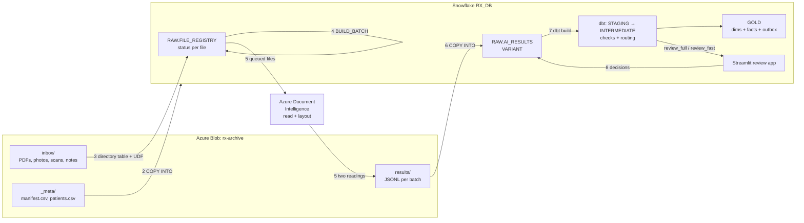

# RxBridge document pipeline: PDFs and images → Snowflake facts and dimensions

Turns legacy medical documents (typed prescriptions, lab reports, phone photos, scanned PDFs, TIFF scans
and handwritten clinical notes) into trusted, patient-linked records in Snowflake. It uses **Azure Blob
Storage**, **Azure AI Document Intelligence**, **Snowflake** and **dbt**.

The project is built so you can **walk through it one stage at a time**. Every stage is one command, and
after each one you can look at the result in Snowflake before moving on.

All documents, names and NHS numbers in this repo are synthetic.

---

## The flow



| # | Stage | Command | Where it runs | What it does |
|---|---|---|---|---|
| 1 | Upload | `samples`, `upload` | Laptop → Azure | Generates 11 test documents and uploads them. Originals are never overwritten. |
| 2 | Load metadata | `load-meta` | Snowflake | `COPY INTO` the vendor manifest (which patient each file is) and the patient list. |
| 3 | Register | `register` | Snowflake | Lists files through the directory table, fingerprints each with a Python UDF (SHA-256, real type, pages), links it to the manifest, and removes duplicates **before** any AI spend. |
| 4 | Batch | `batch` | Snowflake | `RAW.BUILD_BATCH` picks READY files: priority first, then oldest; capped by reports and pages. |
| 5 | Extract | `extract` | Laptop → Document Intelligence | Reads each queued file **twice with two different models** and writes the JSON to `results/` in Azure. |
| 6 | Load results | `load-results` | Snowflake | `COPY INTO` the JSON as VARIANT and moves statuses on (RETURNED, retry, or QUARANTINED). |
| 7 | Transform | `transform` | dbt on Snowflake | Runs the quality checks, routes each document, builds the dimensions and facts, and runs the tests. A failing test stops publishing. |
| 8 | Review | `review …` or the Streamlit app | Snowflake | People approve, correct or reject the flagged documents. Every action is appended to RAW, then `transform` again. |

### What each sample document tests

| File | Type | What happens |
|---|---|---|
| `prescriptions/rx_typed_001.pdf` | Typed PDF | All checks pass → **auto_approve** |
| `prescriptions/rx_typed_001_rescan.pdf` | Byte-identical copy | **DUPLICATE**, never sent to AI |
| `lab/lab_typed_002.pdf` | Typed lab report | **auto_approve**; High/Low/Normal flag calculated in SQL |
| `photos/rx_photo_003.jpg` | Phone photo | Says **5000 mg** metformin → dose check fails → **review_full** |
| `notes/note_hand_004.png` | Handwritten-style note | Handwriting → always **review_full** |
| `prescriptions/rx_typed_005.pdf` | NHS number mistyped on paper | Check digit fails → **review_full** |
| `prescriptions/rx_typed_006.pdf` | Drug not in dm+d | **review_full** |
| `prescriptions/rx_corrupt_007.pdf` | Corrupt file | Fails, retried once, then **QUARANTINED** |
| `scans/rx_scanned_008.pdf` | Scanned PDF, no text layer | OCR → **review_fast** |
| `prescriptions/rx_orphan_009.pdf` | Not in the manifest | **PENDING_MANIFEST**: no patient, so it waits |
| `scans/lab_scan_010.tif` | TIFF scan | OCR reads "HbAlc"; the lab catalogue maps it to HbA1c |

---

## One-time setup (about 30 minutes)

### Step 1 — Azure resources (resource group `rxbridge-snowflake`)

**Option A — Terraform (recommended).** One config creates the storage account, the `rx-archive`
container, Document Intelligence and a Key Vault in your existing resource group. The storage connection
string and the Document Intelligence key go straight into Key Vault; your `.env` only gets the vault URL
and other non-secret values. See [infra/terraform/README.md](infra/terraform/README.md):

```bash
cd infra/terraform
az login && az account set --subscription "<your subscription>"
cp terraform.tfvars.example terraform.tfvars        # set subscription_id
terraform init && terraform apply
cp ../../.env.example ../../.env                     # if you haven't yet
terraform output -raw env_file >> ../../.env         # vault URL + non-secret Azure values
cd ../..
python -m rxpipe secret set SNOWFLAKE_PASSWORD       # after Step 2; skip if you use a key pair
python -m rxpipe secret check                        # each secret should say "key vault"
```
After Step 3, Terraform "phase 2" also grants Snowflake read access to the container, which replaces
the portal click in Step 3.2.

**Option B — Azure CLI.** Run these in [Azure Cloud Shell](https://shell.azure.com). Pick the **same region
as your Snowflake account**:

```bash
RG=rxbridge-snowflake
LOC=centralindia                      # same region as Snowflake
SA=rxbridgedocs$RANDOM                # storage account names are global: lowercase, 3-24 chars

# Storage account + container (private: no public blob access)
az storage account create -n $SA -g $RG -l $LOC --sku Standard_LRS --kind StorageV2 \
   --min-tls-version TLS1_2 --allow-blob-public-access false
az storage container create --account-name $SA -n rx-archive --auth-mode key

# Document Intelligence (F0 = free tier, enough for the samples)
az cognitiveservices account create -n rx-docintel -g $RG -l $LOC \
   --kind FormRecognizer --sku F0 --custom-domain rx-docintel-$RANDOM --yes

# Values for your .env
az storage account show-connection-string -n $SA -g $RG -o tsv          # AZURE_STORAGE_CONNECTION_STRING
az cognitiveservices account show -n rx-docintel -g $RG --query properties.endpoint -o tsv   # AZURE_DI_ENDPOINT
az cognitiveservices account keys list -n rx-docintel -g $RG --query key1 -o tsv             # AZURE_DI_KEY
# Option B has no Key Vault: put AZURE_STORAGE_CONNECTION_STRING and AZURE_DI_KEY in the
# "local fallback" lines at the bottom of .env.
az account show --query tenantId -o tsv                                    # AZURE_TENANT_ID
echo $SA                                                                   # AZURE_STORAGE_ACCOUNT
```

If Document Intelligence isn't offered in your region, use the nearest region that has it. Only the page
text crosses regions, not your Snowflake data.

### Step 2 — Your laptop

```bash
git clone https://github.com/vishal29bhp/rxbridge-snowflake-pipeline.git
cd rxbridge-snowflake-pipeline
python -m venv .venv && source .venv/bin/activate        # Windows: .venv\Scripts\activate
pip install -r requirements-dev.txt
cp .env.example .env                                     # then fill it in with the values from Step 1
```

Optional, but needed for the regression tests and the free offline reader: install
**Tesseract OCR** (Windows: the UB Mannheim installer; macOS: `brew install tesseract`;
Ubuntu: `sudo apt install tesseract-ocr`).

### Step 3 — Snowflake admin setup (run once as ACCOUNTADMIN)

1. Get the script with your values filled in, then paste it into a Snowsight worksheet and **Run All**:
   ```bash
   python -m rxpipe render-sql 00_admin_setup.sql
   ```
2. The last statement (`DESC STORAGE INTEGRATION`) shows two values:
   - **AZURE_CONSENT_URL**: open it in a browser and click **Accept**.
   - Grant Snowflake's app **Storage Blob Data Reader** on the storage account:
     - *Terraform:* copy `client_id=<guid>` from the consent URL into `snowflake_storage_app_client_id` in
       `terraform.tfvars`, then run `terraform apply` again (phase 2).
     - *Portal:* storage account → **Access control (IAM)** → **Add role assignment** → **Storage Blob Data Reader**
       → assign it to **AZURE_MULTI_TENANT_APP_NAME**. Search for the part before the underscore.

     It can take a few minutes to take effect.
3. Snowsight → **Admin → Billing & Terms → Anaconda → Acknowledge**. This is needed once, for the Python UDF.

### Step 4 — Create the pipeline objects

```bash
python -m rxpipe setup          # stages, RAW tables, the fingerprint UDF and the batch procedure
```

To check the Azure connection, run this in Snowsight: `LIST @RX_DB.RAW.DOCS_STAGE;`. It returns an empty
list now (no files yet). An access error means Step 3.2 hasn't taken effect yet.

---

## Walkthrough: one stage at a time

Run each command, then look at what changed. `python -m rxpipe status` shows every file's status at any time,
and `python -m rxpipe sql "<query>"` runs any query.

### Stage 1 — Generate and upload the documents

```bash
python -m rxpipe samples        # writes data/samples/ (open the PDFs and images to see them)
python -m rxpipe upload
```
**Check:** the Azure portal → container `rx-archive` → `inbox/` holds 11 files and `_meta/` holds 2 CSVs.
Run `upload` again: it uploads **0 new** files, because originals are never overwritten.

### Stage 2 — Load the manifest and patient list

```bash
python -m rxpipe load-meta
```
**Check:** `SELECT * FROM RX_DB.RAW.SCAN_MANIFEST;` shows 10 rows. The orphan file has no row; that's deliberate.

### Stage 3 — Register the files

```bash
python -m rxpipe register
```
**Check:**
```sql
SELECT relative_path, status, mime_type, page_count, LEFT(file_sha256, 12) AS sha, last_error
FROM RX_DB.RAW.FILE_REGISTRY ORDER BY relative_path;
```
You should see **8 READY**, **1 DUPLICATE** (the rescan, which has the same SHA-256 as `rx_typed_001`) and **1 PENDING_MANIFEST**
(the orphan). Note `mime_type`: it comes from the file's bytes, not its name.

### Stage 4 — Build a batch

```bash
python -m rxpipe batch
```
It prints something like `BATCH_20261012_101500 (8 reports)`. All 8 fit because the walkthrough uses
`RX_MIN_READY=1`; in production it waits for 5,000 or for 6 hours.
**Check:** those 8 rows are now `QUEUED` with that `batch_id`, and `attempts = 1`. Lab reports come
first because they have `priority = 1` in the manifest. Run `batch` again: it says nothing is READY.

### Stage 5 — Read the documents

```bash
python -m rxpipe extract
```
Each queued file is downloaded and read by `prebuilt-read` (extract) and `prebuilt-layout` (verify).
**Check:** Azure → `results/BATCH_…/results_….jsonl`. Open it. It has two lines per document, and one
`"step": "error"` line for the corrupt PDF.

### Stage 6 — Load the results

```bash
python -m rxpipe load-results
```
**Check:**
```sql
SELECT report_id, step, model, payload:doc:medications AS meds, error FROM RX_DB.RAW.AI_RESULTS;
SELECT status, COUNT(*) FROM RX_DB.RAW.FILE_REGISTRY GROUP BY 1;   -- 7 RETURNED, corrupt back to READY
```
Run `load-results` again: nothing changes, because `COPY` never loads the same file twice.

Now **retry the corrupt file**: `batch`, `extract`, `load-results` again. Its second failure makes it
**QUARANTINED**, with the error in `last_error`.

### Stage 7 — Transform with dbt

```bash
python -m rxpipe transform
```
This runs seeds, the patient snapshot, every model and every test. **Check the routing:**
```sql
SELECT source_file, route, review_status, flag_reasons FROM RX_DB.GOLD.FCT_REVIEW_QUEUE ORDER BY route;
```
Then the star schema. Only approved documents are here:
```sql
SELECT * FROM RX_DB.GOLD.FCT_DOCUMENT;
SELECT m.drug_name_read, m.dose_value, m.dose_unit, m.frequency, p.registered_clinic, d.calendar_date
FROM RX_DB.GOLD.FCT_MEDICATION m
JOIN RX_DB.GOLD.DIM_PATIENT p ON p.patient_key = m.patient_key
JOIN RX_DB.GOLD.DIM_DATE d    ON d.date_key = m.prescribed_date_key;
SELECT * FROM RX_DB.GOLD.FCT_LAB_RESULT;     -- flag calculated from the printed range
SELECT * FROM RX_DB.GOLD.OUTBOX;             -- what would be published to RxBridge
```

### Stage 8 — Review, and see the publish gate work

```bash
python -m rxpipe review list
python -m rxpipe review show <report_id of rx_photo_003.jpg>
```

**First, the gate.** Approve the photo **without** fixing the 5000 mg dose:
```bash
python -m rxpipe review approve <report_id>
python -m rxpipe transform
```
`assert_gold_doses_within_range` **fails**, and dbt **skips `outbox`**. The wrong dose reached GOLD's
medication table, but it was never published. Now fix it properly:
```bash
python -m rxpipe review correct <report_id>-0 --dose 500
python -m rxpipe transform
```
All tests pass. `fct_medication` shows 500 mg with `last_changed_by = reviewer`, and the outbox now
includes the photo. The original reading is still in `RAW.MEDICATION_EVENTS` (op `I`, 5000) for audit.

Review the others the same way: reject the unrecognised drug line (`review reject-line <id>-0`), and
approve or reject the note and the mistyped-NHS prescription.

To use the **Streamlit app** instead, run `python -m rxpipe deploy-app`, then open Snowsight → Projects →
Streamlit → **RX_REVIEW**.

### Stage 9 — SCD2: a patient changes clinic

```bash
python -m rxpipe samples --move-patient A "Northgate Surgery" 01/07/2021
python -m rxpipe upload
python -m rxpipe load-meta
python -m rxpipe transform
```
```sql
SELECT nhs_number, registered_clinic, version_no, valid_from, valid_to, is_current
FROM RX_DB.GOLD.DIM_PATIENT WHERE nhs_number = '9434765919';
```
There are now two versions. The 2019 prescription still links to **Riverside Clinic**, while anything dated
after 1 July 2021 links to Northgate. Each version is valid from the business date `clinic_since`, not
from the date we loaded the change.

### The late manifest row

Add a line for `prescriptions/rx_orphan_009.pdf` to `data/samples/_meta/manifest.csv`
(patient C: `4010232137,prescription,Riverside Clinic,28/09/2026,0`), then run `upload`, `load-meta` and
`register`. The file moves from **PENDING_MANIFEST** to **READY**.

### Start again

```bash
python -m rxpipe reset --yes
```
This empties RAW, drops the dbt schemas and deletes `results/`. Your documents stay in Azure.

---

## Tests

| Kind | Command | Needs | What it covers |
|---|---|---|---|
| Unit | `pytest tests/unit` | Nothing | NHS check digit, UK dates, units, parsers, extract step with fake readers, Azure reader with a fake client, SQL scripts split correctly, sample data |
| Regression (extraction) | `pytest tests/regression` | Tesseract | Reads all 10 documents and compares them with the golden set. Fails if any document reads worse than its recorded baseline. |
| dbt data tests + unit tests | `python -m rxpipe transform` | Snowflake | 60 data tests (uniqueness, relationships, accepted values, contract, publish gates) and 4 dbt unit tests (routing rules, NHS check) |
| Regression (outcomes) | `python -m rxpipe transform --regression` | Snowflake, samples | Every sample file ends in its expected status, and risky documents are never auto-approved |
| Integration | `pytest -m integration -s` | Azure + Snowflake | The whole flow end to end, including the reviewer correction and the SCD2 move. Run `reset --yes` first. |
| Manual | [docs/MANUAL_TEST_PLAN.md](docs/MANUAL_TEST_PLAN.md) | Azure + Snowflake | 20 checks to tick off by hand, with the expected result for each |

`pytest` on its own runs unit + regression (integration is opt-in).

---

## Project layout

```
rxpipe/            Python: samples, Azure Blob, Document Intelligence readers, extract step, review CLI
snowflake/         SQL, numbered in run order (00 admin, 01 objects, 10-40 pipeline stages, 90 automation)
snowflake/streamlit/review_app.py   Streamlit in Snowflake review queue
dbt/               staging → intermediate (checks) → marts (GOLD), seeds, snapshot, tests, contract
tests/             unit, regression (golden set), integration
docs/              manual test plan
infra/terraform/   Azure resources in rxbridge-snowflake (storage, Document Intelligence, access)
.github/workflows/ CI: tests, dbt parse, terraform validate
```

## Going automatic

After the walkthrough, `snowflake/90_automation.sql` replaces the manual steps:
- the directory table auto-refreshes from Azure Event Grid
- Snowpipe loads results as they land
- a task builds batches every 15 minutes

Run `extract` and `transform` on a schedule, for example with GitHub Actions, an Azure Container Apps job,
or dbt Cloud.

## Cost

- **Snowflake:** XSMALL warehouses that auto-suspend after 60 seconds, plus a 20-credit monthly resource monitor.
- **Document Intelligence F0:** free, but limited to 500 pages a month. Each sample run uses about 20 pages,
  because every page is read twice.
- **Blob storage:** pennies.

## Troubleshooting

| Symptom | Fix |
|---|---|
| `LIST @…DOCS_STAGE` access denied | Step 3.2: consent, then **Storage Blob Data Reader** for Snowflake's app; wait 5–10 minutes |
| `Anaconda terms` error creating the UDF | Step 3.3 |
| `register` adds nothing | Files must be under `inbox/` in the container; run `upload` |
| Everything stuck `QUEUED` | `extract` hasn't run, or `load-results` hasn't loaded its file |
| dbt contract error on `fct_document` | Snowflake returned a different type; align the cast in `fct_document.sql` with `_marts.yml` |
| Document Intelligence `401` | Check `AZURE_DI_ENDPOINT` (ends with `/`) and `python -m rxpipe secret check` |
| Key Vault `403 Forbidden` | Your login needs **Key Vault Secrets Officer** on the vault (Terraform grants it); run `az login` again |
